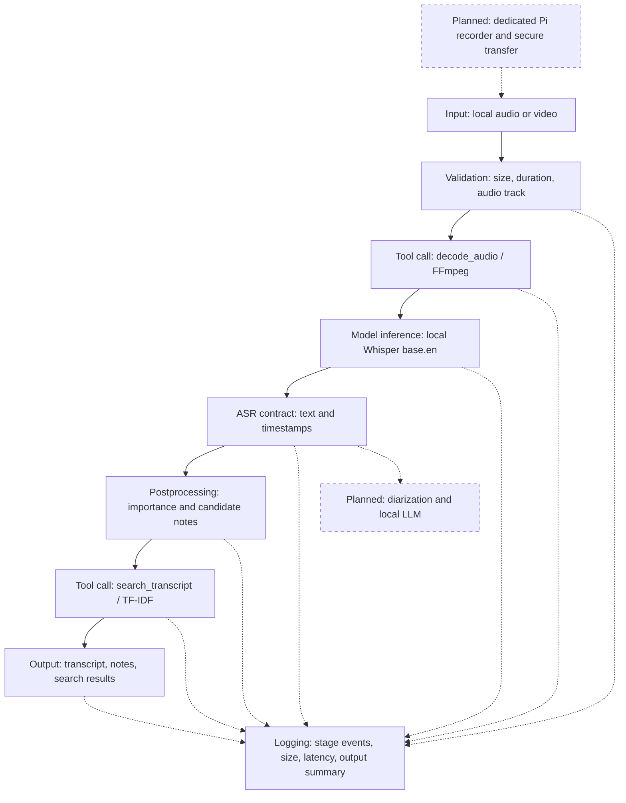

# Implemented architecture and contracts

Solid nodes are implemented in prototype v0.1. Dashed nodes are planned.

Validation invokes a separate `inspect_media`/ffprobe tool. Tool names are
resolved from a fixed Python registry. The controller selects calls; transcript
content cannot select arbitrary executable commands. There is no agent loop
or full RAG. TF-IDF retrieval operates only over the current recording.

## Boundary 1: model inference -> postprocessing

Input to model: mono waveform `numpy.ndarray`, shape `(N,)`, dtype `float32`,
16,000 samples/second, decoded from signed 16-bit PCM to approximately [-1, 1).
Duration `0 < N/16000 <= 7200`. Model adapter emits JSON-compatible
`list[{start: float, end: float, text: str}]`.

Postprocessor output: sentence passages `list[{id: int, start: float, end: float,
text: str}]`, grouped candidate notes `dict[str, list[passage + importance_score]]`.
Sentence fragments crossing ASR turns are joined; the note interval covers all
contributing segments. Speaker identity is not inferred.

Checks: at most 100,000 segments, nonempty text <=20,000 characters per segment,
finite `0 <= start <= end <= decoded_duration + 1 second`, starts in temporal
order. A one-second tolerance accommodates ASR endpoint padding, so timestamps
are approximate. Wrong types or invalid times raise `ValueError`; no notes are
written. Empty list is valid: `no_speech` status and explicit no-speech output.
Structural checks do not establish transcription accuracy.

## Boundary 2: retrieval tool -> output formatter

Tool input: validated sentence passages and a query `str`, 1-512 non-whitespace
characters (length bound applies to the complete query), `limit: int` 1-20,
default 5. Retrieval output: up to `limit` objects
`{id: int, start: float, end: float, text: str, score: float}`. Scores are positive
cosine similarities; rounding can approach zero. They are not probabilities.

Formatter output: Markdown bullets with timestamp, source text and score, plus
JSON search results. All IDs, times and text must match an existing source
passage exactly; scores must be finite and within [0, 1] with 1e-6 numerical
tolerance. Malformed results raise `ValueError` and fail the stage. No positive
similarities yields `[]` and the message "No matching passages found." Nothing
is invented to fill a missing result. Queries do not modify the recording.

## Dynamic notes policy

Automatic notes use common English decision/action/question cues, sentence
centrality computed from TF-IDF vectors, and emphasis words such as "important"
and "exam". At most eight items per section are retained, duplicates suppressed,
and selected notes are placed in recording order. Empty sections are omitted.
This needs no user-written vocabulary file, but its built-in English cues are
limited. It provides evidence-preserving candidate notes rather than semantic
reasoning about implicit actions, jokes, quotations or speaker identity.
