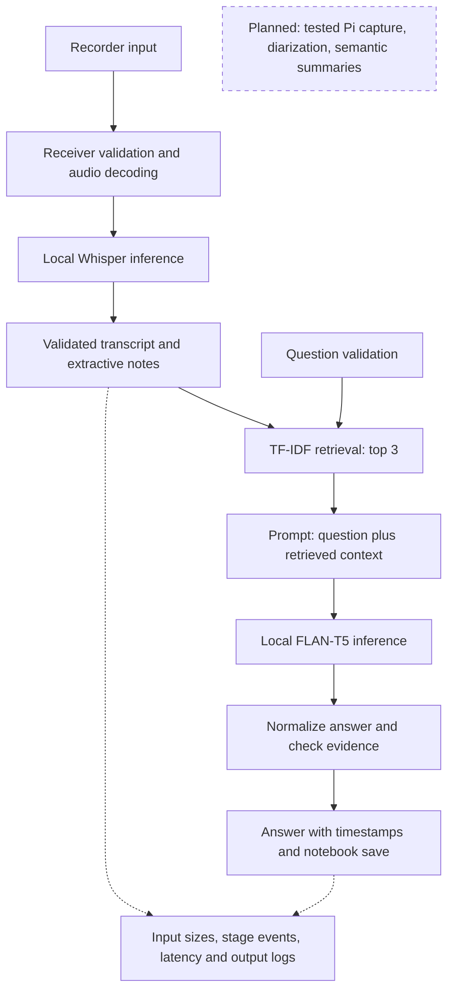

# SecureNote 0.5: recording pipeline and local RAG

Recorder and receiver are separate roles; the demo actually transfers media over
loopback HTTP. Remote transfer requires HTTPS. RAG reads local transcripts and
runs an actual language model after retrieval. It does not require model-directed
tools or an agent loop: **RAG is the assignment option implemented here**.

## Retriever to prompt builder

Input: question string of 1-512 characters and validated transcript passages.
Output: up to 3 chunks with text <=600 characters, source ID, passage ID, finite
start/end seconds and TF-IDF cosine score >=0.20. The prompt builder checks the
schema and includes complete chunks within 512 tokens. Question/instructions
must fit 160 tokens. Empty retrieval returns not_found and skips generation.
Malformed chunks fail before model inference; oversized prompts are not silently
truncated. Ranking is lexical, not semantic, and its threshold is not calibrated.

## Generator to postprocessor

Input: decoded text (1-2000 characters), produced with at most 64 new tokens,
and the exact supplied context chunks. Output: answer, status and sources.
An exact normalized wording match yields answered; missing support yields
needs_review; an explicit abstention also yields needs_review. Either outcome triggers one retry against the strongest supplied passage, with the same evidence check. Invalid output fails. The
check can reject correct paraphrases and cannot prove semantic correctness.

## Security and deployment

The browser session, Host/Origin and CSRF controls cover the question endpoint.
Sources are server-selected paths/IDs, not model-generated paths. Generation is
serialized. Active answers block recording deletion; permanent deletion removes
associated workspace answers. CPU float32 RAG is independent of optional CUDA
Whisper. Both models are local; download commands are setup operations only.
