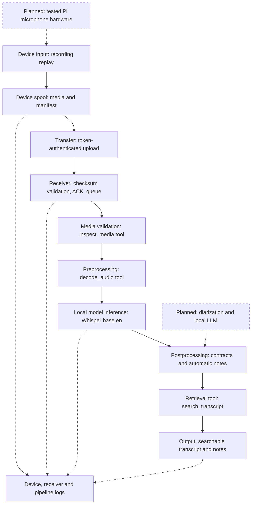

# SecureNote - Project Assignment 2

**First working prototype: emulated recorder to laptop processor.** Two independent roles run on one laptop now: a lightweight recorder queues and transfers media; the receiver runs local AI and produces searchable notes. Later, the recorder moves to a Pi Zero 2 W and the receiver moves to a server. Their transfer contract remains the same.

## 1. Implemented prototype architecture

# Implemented recorder/processor architecture, version 0.2



Device and processor are independent programs with separate directories. The
same-PC demo uses loopback HTTP; cross-machine deployment requires HTTPS.
The recorder has no ASR/LLM dependency. Detailed recorder/receiver contract,
acknowledgment semantics, retry behavior and migration instructions are in
TWO_ROLE_DEPLOYMENT.md. Capture is file replay; transport and processing run.

## Device-to-receiver boundary

Input is a raw media body and schema-1.0 manifest with recording/device IDs,
ISO-8601 capture time, byte count and SHA-256. Required token, one Content-Length,
2-GiB size cap, strict manifest shape and body hash are checked. A successful
receipt contains ID/size/hash; only then does the device mark delivery. The
receiver publishes a persistent job before acknowledgment. Bad requests return
400/401 with no published job; missing acknowledgment leaves a retryable device
copy. The same ID+manifest is idempotent. A later media/ASR failure is reported
as a failed job, separately from delivery acknowledgment.


**Device side:** device.py imports a recording to emulate capture, writes a persistent spool and manifest, uploads bytes and records acknowledgment. Failed transfers remain queued for retry. **Laptop side:** laptop.py authenticates the request, verifies its size/hash, publishes a stored job, acknowledges delivery and processes one recording at a time. Acknowledgment means stored, not that transcription succeeded.

Processing validates media, invokes allowlisted inspect_media/decode_audio tools, runs local Whisper, validates ASR segments, selects important transcript sentences, omits empty note sections and calls the search_transcript retrieval tool. This satisfies the tool-call option. Search is lexical retrieval, not full RAG or an LLM agent loop.

**Separation and security:** the device uses only Python standard-library code; all model dependencies remain on the laptop. Loopback HTTP emulates transfer on one computer. Separate-machine operation requires HTTPS with certificate verification. A bearer token protects uploads/status. Media, queue data and results are plaintext and require protected storage. No hosted model API is used.

## 2. Three real recorder-to-processor runs

The demo launches the laptop receiver and invokes the recorder as separate OS processes. Synthetic recordings are imported, actually uploaded over loopback HTTP, acknowledged and transcribed locally. Execution used Linux x86-64, AMD EPYC 9V74, Python 3.12.14 and four CPU inference threads. These are short smoke tests, not performance estimates for the Windows laptop. The earlier standalone inference tests also blocked Python socket connections.

## A. Business meeting / WAV

**Input:** business.wav; 826,348 bytes; 18.74 s. Source excerpt: &quot;Alice will send the revised budget by Friday.&quot;
**Output:** Decision: We decided to use the local server for all meeting recordings. Action: Alice will send the revised budget by Friday.
**Result:** device delivered; processor completed; 6 notes. Pipeline 1.648 s; capture/transfer/processing 1.787 s.

```text
{"stage":"transfer_validation","event":"accepted",
 "input_bytes":826348,"latency_ms":6.11}
{"stage":"processor","event":"finished",
 "status":"completed","latency_ms":1647.99}
```

## B. Class lecture / MP3

**Input:** lecture.mp3; 98,238 bytes; 24.50 s. Source excerpt: &quot;Remember, the discount factor controls how much future rewards matter.&quot;
**Output:** Key point: Remember, the discount factor controls how much future rewards matter. Key point: The homework is due on Friday.
**Result:** device delivered; processor completed; 6 notes. Pipeline 1.797 s; capture/transfer/processing 1.982 s.

```text
{"stage":"transfer_validation","event":"accepted",
 "input_bytes":98238,"latency_ms":2.46}
{"stage":"processor","event":"finished",
 "status":"completed","latency_ms":1797.16}
```

## C. Recorder planning / MP4

**Input:** planning.mp4; 225,989 bytes; 22.70 s. Source excerpt: &quot;We agreed to keep the original recordings on an encrypted drive.&quot;
**Output:** Decision: We agreed to keep the original recording on an encrypted drive. Key point: The important constraint is battery life.
**Result:** device delivered; processor completed; 7 notes. Pipeline 1.455 s; capture/transfer/processing 1.604 s.

```text
{"stage":"transfer_validation","event":"accepted",
 "input_bytes":225989,"latency_ms":3.79}
{"stage":"processor","event":"finished",
 "status":"completed","latency_ms":1454.7}
```

Excerpts project fields from genuine JSONL records. Full manifests, delivery receipts, receiver logs, ASR transcripts, notes and job states are under examples/distributed-verified/. Automatic notes also include timestamped search results. Query an existing transcript using securenote.py search RESULT-DIRECTORY "budget". The lecture misheard parts of its definition and final question; the artifacts preserve these errors rather than concealing them.

**Reproduce:** python tools/run_distributed_demo.py --output demo-two-role. This also performs the intentional corrupt-transfer failure test. No Pi, microphone or external server is needed for the demo.

## 3. Two stage interfaces

## Boundary A - Recorder transfer to receiver queue

**Input:** POST /v1/recordings with raw media bytes, one Content-Length, bearer token and a base64 JSON manifest: {schema_version: "1.0", recording_id: 32-char hex, device_id: 1-64 safe characters, captured_at: ISO-8601, input_bytes: int, sha256: 64-char hex}. Maximum size is 2 GiB; manifest header is at most 2048 bytes. Device filenames never choose receiver paths.

**Output:** a stored recording, manifest and queued job, plus HTTP 201 receipt {recording_id, input_bytes, sha256, status: "accepted"}; an identical repeat returns HTTP 200 without a second job. The recorder compares the receipt before marking delivered. A separate authenticated status query reports queued, processing, completed or failed.

**Missing/invalid:** missing authentication returns 401. Invalid manifest, size disagreement, corrupt bytes or conflicting ID return 400 without publishing a job. Interrupted uploads are not processed. Failed/missing acknowledgment leaves the recorder item queued for retry. Accepted media still undergoes audio-track/duration/format validation before inference. Delivery does not imply valid speech.

## Boundary B - Model inference to postprocessing

**Input:** mono waveform float32 array (N,), 16,000 Hz, approximately [-1,1), duration 0-7200 s excluding zero. The ASR adapter emits list[{start: float, end: float, text: str}]. **Output:** sentence passages [{id, start, end, text}] and nonempty note sections containing selected source passages plus importance scores. Sentence fragments are joined across ASR segments; intervals are approximate.

**Missing/invalid:** reject non-list/oversized output, empty or wrong-type text, nonfinite times, inverted intervals or unordered starts. Limits: 100,000 segments, 20,000 characters/segment, 0 &lt;= start &lt;= end &lt;= duration + 1 s. Invalid results fail the job before notes. An empty list yields no_speech with an explicit message and zero notes. Structural checks cannot establish transcription accuracy.

## 4. Model choice and assumptions

**Whisper base.en**, 74M parameters [1], runs with faster-whisper 1.2.1/CTranslate2 4.6.0 on the processor. The checkpoint stores FP16 weights [2]; inference uses CPU int8. Local weights occupy about 141 MiB; there is no paid inference service. Three short two-role runs completed successfully with pipeline times of 1.648, 1.797, 1.455 s. ASR mistakes occurred. No float32 accuracy comparison was done, so their cause cannot be attributed to quantization.

The intended laptop has an i5-13420H, 32 GB RAM and RTX 4050 6 GB; its actual performance was not measured. CPU mode avoids GPU driver requirements. **Assumption 1:** intelligible English speech, limited overlap; no reliable speaker identity is assumed. **Assumption 2:** transcripts/timestamps are fallible evidence; a user verifies consequential notes. Neither note selection nor the model invents an action owner or deadline intentionally.

## 5. Intentional transfer failure

**What changed:** after the emulated device prepared a legitimate recording and SHA-256 manifest, the demo flipped one byte of the uploaded body while retaining the original checksum. Authentication and byte count were correct. This intentionally breaks the recorder-to-receiver data contract.

**Result:** the receiver returned HTTP 400, logged a validation failure, cleaned up partial storage and published no processing job. It did not crash or silently generate wrong notes. The device copy remained queued and intact. **Which boundary let it through?** the simulated sender supplied corrupt bytes; the receiver intake boundary caught them before ASR. No downstream stage accepted the damaged payload.

```text
{"stage":"transfer_validation","event":"rejected",
 "error_type":"ValueError","latency_ms":4.64}
{"http_status":400,"published_job":false,
 "device_status":"queued"}
```

**What to add:** the checksum catches accidental corruption, while the token and TLS protect the channel. Add per-device credentials, key rotation, storage quotas, explicit retry scheduling/backoff and labeled speech-quality checks. A checksum alone cannot establish sender identity or factual accuracy. Fourteen tests passed, including corrupted transfer, wrong token, queue persistence across receiver restart, unavailable receiver, idempotent retransmission and model/retrieval contracts.

## 6. Gap analysis and next steps

**Built:** portable recorder role, persistent spool, real authenticated upload/ACK, receiver queue, restart handling, local ASR, registered tools, automatic extractive notes, lexical retrieval, contracts and logs. **Emulated:** microphone capture is replayed from a local recording. An optional Linux arecord adapter is supplied but not hardware-tested. **Simplified:** base.en replaces large-v3 and extractive importance scoring replaces the proposed local LLM. These stages execute; they are not mocked model responses.

**Missing/fragile:** tested Pi hardware, continuous recorder service, robust power-loss recovery, diarization, semantic notes/search, per-device enrollment, enforced retention and production service hardening. ASR mistakes and cue-based importance selection are most fragile. Before real users, add encrypted storage/ACLs, authenticated TLS deployment, consent indicators, disk/queue alerts, job heartbeats, ASR timeouts, failure-rate and latency-percentile monitoring, and consented accuracy audits. Move device code to Pi and processor code to server without changing the manifest protocol. Retained transcripts support search and differ intentionally from Part 1 deletion plans.

## Security limits and run instructions

Loopback HTTP is only for same-PC emulation; remote endpoints/listeners require HTTPS. Certificate loading and verification are implemented; actual remote TLS and Pi hardware deployment were not tested. The minimal HTTP server has no production traffic hardening. The shared token is not per-device authorization. Media, transcripts and notes are plaintext: local AI is not disk encryption or a security certification. Use public/synthetic inputs for this demo.

**Run:** follow README setup, then python tools/run_distributed_demo.py. For manual use, run laptop.py serve in one terminal and device.py enqueue FILE followed by device.py send --token-file laptop-state/device.token in another. docs/TWO_ROLE_DEPLOYMENT.md explains later Pi/server placement. Code, synthetic media and authentic evidence accompany this four-page PDF.

**Primary references:**
[1] Model sizes: https://github.com/openai/whisper
[2] Checkpoint/precision: https://huggingface.co/Systran/faster-whisper-base.en
[3] Media protocol restrictions: https://ffmpeg.org/ffmpeg-protocols.html
