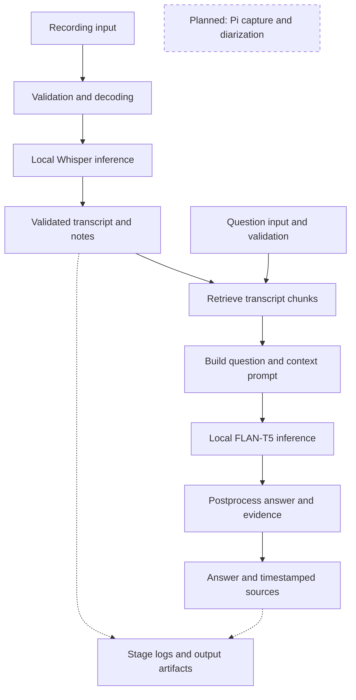

# SecureNote: A Local Meeting Recorder

Michael Grajera  |  ECE 6540: AI Architecture  |  Project Assignment 2  |  October 23, 2026

I want SecureNote to make a class or meeting easier to review without taking notes throughout the discussion. The prototype accepts a recording, transcribes it locally, selects useful passages, and answers questions using the transcript. The recorder is emulated on the same computer as the processor. Later, it can move to a Pi Zero 2 W while a laptop or server runs the models.

## 1. Implemented architecture

Figure 1. The stored transcript supplies evidence to the RAG pipeline before answer generation.



The recorder queues a local copy and sends it to a separate receiver process. The receiver checks the token, byte count and SHA-256 before acknowledging storage. Media must be nonempty, at most 2 GiB, and contain decodable audio of no more than two hours. FFprobe inspects the file and FFmpeg converts it to mono PCM. Whisper produces timestamped text; postprocessing checks the segment format and groups selected sentences into notes.

The required additional component is RAG. A question retrieves up to three transcript chunks. Those chunks become context in the prompt sent to FLAN-T5-small, which generates a short answer locally. The application attaches matching source timestamps and lets the user listen or save the answer. Empty retrieval skips generation and reports that the search found no relevant passages. An abstention or unsupported answer triggers one retry on the strongest passage; another failure asks the user to review the evidence. RAG fits transcript questions without model-directed tools or an autonomous agent loop.

The browser also provides the full transcript, editable notes, search, export and deletion. Each pipeline logs input size, stages, latency and output metadata. Content stays out of default logs; transcript and answer files are stored separately. The synthetic demonstration enables answer text in its logs so the results can be inspected.

# 2. Three complete example runs

The demo transferred and transcribed three synthetic recordings, then answered one question about each transcript. It ran on a Linux AMD EPYC 9V74 test host with Python 3.12.14 and four CPU threads per model. These are not laptop or Pi timings. Python socket connections were blocked during the RAG runs; local generation still completed.

## A. Business meeting

Input: business.wav, 826,348 bytes, 18.74 seconds of decoded audio.
Question: When will Alice send the revised budget?

Generated answer: "by Friday"
Retrieved evidence [7.04 s]: Alice will send the revised budget by Friday.

Transcription produced 6 segments and 5 notes. Recording pipeline: 2.808 s. RAG request: 2.502 s; 1 retrieved chunk, 47 prompt tokens.

```text
{"stage":"input","event":"received","input_characters":40}
{"stage":"model_inference","event":"completed","latency_ms":91.58}
{"stage":"output","event":"result","answer":"by Friday"}
```

## B. Class lecture

Input: lecture.mp3, 98,238 bytes, 24.44 seconds of decoded audio.
Question: What controls how much future rewards matter?

Generated answer: "discount factor"
Retrieved evidence [6.52 s]: Remember, the discount factor controls how much future rewards matter.

Transcription produced 4 segments and 5 notes. Recording pipeline: 1.541 s. RAG request: 0.079 s; 1 retrieved chunk, 50 prompt tokens.

```text
{"stage":"input","event":"received","input_characters":45}
{"stage":"model_inference","event":"completed","latency_ms":77.35}
{"stage":"output","event":"result","answer":"discount factor"}
```

## C. Recorder planning

Input: planning.mp4, 225,989 bytes, 22.71 seconds of decoded audio.
Question: Where did we agree to keep the original recording?

Generated answer: "encrypted drive"
Retrieved evidence [2.38 s]: We agreed to keep the original recording on an encrypted drive.

Transcription produced 7 segments and 6 notes. Recording pipeline: 1.084 s. RAG request: 0.082 s; 1 retrieved chunk, 52 prompt tokens.

```text
{"stage":"input","event":"received","input_characters":50}
{"stage":"model_inference","event":"completed","latency_ms":80.11}
{"stage":"output","event":"result","answer":"encrypted drive"}
```

These are original v0.5 measurements; the patched code reproduced all three answers. Log excerpts retain selected fields from real records. The first RAG request includes 2.407 seconds of model loading; later requests reuse the loaded model. Full inputs, transcripts, notes, answers and stage logs are in examples/assignment-v05/. The short clips demonstrate the pipeline, not expected speed or accuracy for a full meeting.

One limitation remains visible in the lecture transcript: Whisper wrote "A policy map sustained to an action." Retrieval and generation cannot repair incorrect source material reliably, so the recording remains available for review.

```text
python tools/run_assignment_demo.py --output demo-assignment-new
```

Run after model setup, using a fresh output folder. This reproduces all three examples and the missing-retrieval test below.

# Stage interfaces and model choice

## 3. Two stage interfaces

Boundary A: retriever to prompt builder. The retriever takes a question string of 1-512 characters and validated transcript passages. It splits long passages at word boundaries and returns a list of up to three chunks scoring at least 0.20 under TF-IDF cosine similarity. Each chunk has {id: int, text: str, source: str, start: float, end: float, score: float}. Text is limited to 600 characters; source identifies the recording; times are seconds.

The prompt builder produces a string containing instructions, the question and the selected chunk text, plus the list of supplied chunks and its token count. The prompt is at most 512 model tokens. Only complete chunks that fit are included. The question and instructions alone must fit within 160 tokens, reserving room for context.

Invalid or missing data: reject malformed fields, duplicate IDs, empty text, nonfinite scores/times, out-of-range values and an oversized question. Empty retrieval returns an explicit not_found result and never calls the generator. If chunks exist but none fits the prompt, the run fails with a clear error rather than silently truncating the context.

Boundary B: answer generator to postprocessing. Input is the decoded model response as a string, along with the exact chunks supplied in the prompt. Decoding is limited to 64 new tokens. Output is {answer: str, status: str, sources: list}, with source records carrying their original text, recording ID, timestamps and retrieval score.

Invalid or missing data: empty, non-string, oversized or token-limit responses fail validation. Postprocessing normalizes spacing and checks whether the answer wording occurs in a supplied chunk. A match produces answered status and source links; an unmatched response becomes needs_review. An abstention also becomes needs_review. Either outcome triggers one retry with a simpler prompt and the highest-scoring supplied chunk; the same check runs again. A failed retry retains needs_review and the passages. Lexical matching can reject valid paraphrases and accept incomplete answers; it does not verify meaning. Source links are assigned by code.

## 4. Models, precision and assumptions

Whisper base.en handles transcription through faster-whisper 1.2.1/CTranslate2 4.6.0. I chose it to get a small local prototype running; its model directory is about 141 MiB. It uses CPU int8 here. The three recording pipelines took 1.084-2.808 seconds, and transcription errors occurred. Without a float32 comparison, I cannot attribute those errors to quantization.

FLAN-T5-small handles answers through Transformers 4.57.1 and PyTorch 2.8.0. Its loaded model has 76,961,152 parameters; the checkpoint is about 294 MiB. It runs on CPU in float32, without quantization, and generated these short answers in 77-92 ms after loading. It was chosen for a small memory footprint and simple local setup, not advanced reasoning. Both models require one-time downloads and local compute, with no paid inference API. Whisper CUDA support exists but was not verified on the target laptop.

Assumption 1: inputs contain understandable English with limited overlapping speech. Noise and unfamiliar terminology can damage the transcript before retrieval begins.

Assumption 2: a short answer can often be found in a few transcript passages. The generator may still choose the wrong passage or misinterpret it, so consequential answers require human review.

Model documentation: huggingface.co/google/flan-t5-small; github.com/SYSTRAN/faster-whisper. The report uses measured prototype results rather than claiming benchmark accuracy.

# Failure test and remaining work

## 5. Failure test and observed answer failure

Deliberate failure. I replaced the business-question retrieval result with an empty list before prompt building, leaving the question and transcript unchanged. The answer was present in the transcript but unavailable to the generator. The patched run returned "No relevant passages were found by this search. Try different wording." It finished in 1.17 ms without crashing or generating an unsupported answer.

```text
{"stage":"retrieval","event":"result","chunk_count":0}
{"stage":"model_inference","event":"skipped","reason":"no_evidence"}
{"stage":"run","event":"finished","status":"not_found",
 "latency_ms":1.17}
```

The retriever-to-prompt boundary accepts an empty list, but the guard prevents it from reaching inference. This catches missing evidence, not a retrieval miss. I would add labeled questions with known source passages and track retrieval misses separately from model failures.

Observed failure with evidence present. The question "when was the wild west of AI?" retrieved a passage at 18:30 containing "late 2024, early 2025," yet the model answered "not found." A local reproduction using that excerpt and the retrieved "AI person" distractor confirmed the false negative. The generator-to-postprocessing boundary had accepted the abstention as evidence of absence.

The patch retries once using the strongest passage and a simpler prompt. The reproduced answer changed to "late 2024," with the correct source, but still omitted "early 2025." Failed answers now request evidence review rather than claim absence. This is a partial fix: a literal text match does not check completeness. A stronger local model, better context retrieval and tests of complete answers remain future work.

## 6. Comparison with Assignment 1 and next steps

Built: local transcription, candidate notes, logging, recorder queue and acknowledged transfer, playback, editable notes, deletion and RAG answers. The Pi role is emulated with files; physical capture is untested. Base.en replaces large-v3, and sentence scoring supplies notes. FLAN-T5 answers questions; the proposed full-meeting Qwen summarizer, diarization, inferred owners, automatic fallback and cache expiry are not built. Audio is retained for review rather than automatically deleted.

Answer quality is the most fragile part: keyword retrieval misses meaning, and the small generator can refuse or omit information even with the right evidence. Before real use, I would monitor queue age, failed jobs, latency, disk usage, empty searches, retries and needs_review rates, with human checks for answer accuracy. Next steps are a labeled question set, improved local answering, tested Pi capture, per-device credentials, encrypted storage, retention rules and hard timeout recovery.

## Running it and protecting the recordings

Apply SecureNote_RAG_Fix.zip to the v0.5 code before running this revision. The README covers FFmpeg, base dependencies, CPU PyTorch and requirements-rag.txt. Download both models once, then start the review workspace:

```text
python securenote.py download-model --model base.en
python ask.py download-model
python review.py
```

Inference stays local. The browser checks its private session and mutation requests; remote recorder transfer requires verified HTTPS. Stored files need volume encryption for protection at rest. Trash retains recordings until permanent deletion; independent copies and backups remain. The code is a prototype, not a validated deployment for confidential meetings.

Validation: 37 unit tests passed after the patch. All three original answers were reproduced with local inference; the Wild West test used supplied excerpts, not the full recording. Earlier browser tests covered playback and notes. Submit this report with the v0.5 code plus the RAG patch, or a code folder with that patch applied.
