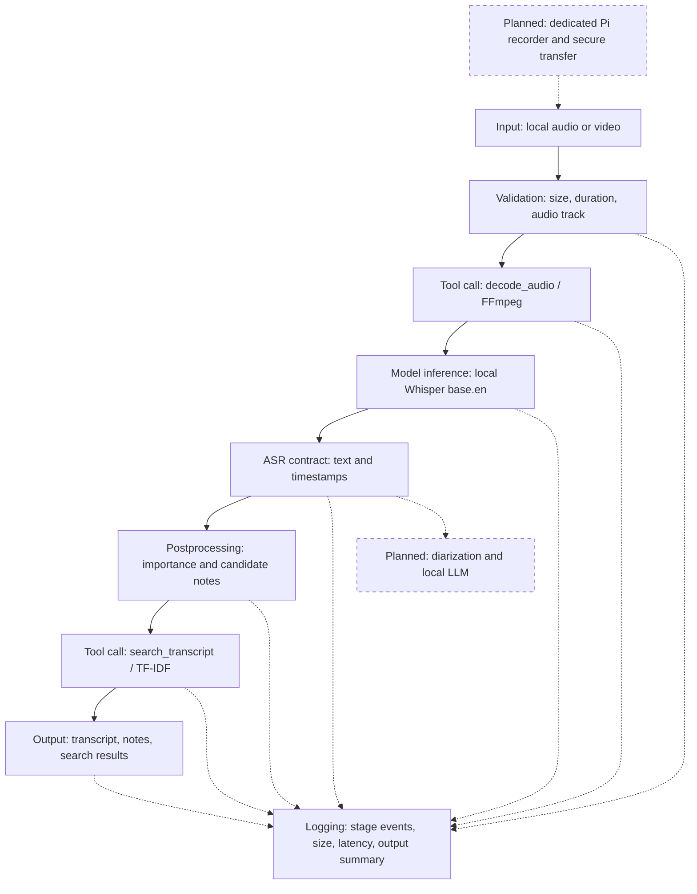

# SecureNote - Project Assignment 2

**First working prototype: local recording to transcript, notes and search.** The target users are students and meeting participants who need useful records without hosted model inference. This version processes an existing recording on a laptop/server. A dedicated Pi Zero 2 recorder and secure offload remain future work.

## 1. Implemented architecture

# Implemented architecture and contracts

Solid nodes are implemented in prototype v0.1. Dashed nodes are planned.



Validation invokes a separate `inspect_media`/ffprobe tool. Tool names are
resolved from a fixed Python registry. The controller selects calls; transcript
content cannot select arbitrary executable commands. There is no agent loop
or full RAG. TF-IDF retrieval operates only over the current recording.


Each box marks a stage boundary. Registered local tools have fixed names and signatures: **inspect_media**, **decode_audio** and **search_transcript**. The controller chooses these calls, validates their results and logs execution. This implements the tool-call option; it is not an LLM-selected agent loop or full RAG. Retrieval uses only this recording's transcript.

## What runs now

The CLI accepts common FFmpeg-decodable audio/video containers, checks for a local nonempty file up to 2 GiB and 2 hours, validates an audio track and converts it to mono 16 kHz PCM. Whisper produces text and timestamps. Postprocessing joins sentence fragments, scores importance, groups candidate decisions/actions/questions/key points and omits empty sections. Notes copy transcript sentences; owners and deadlines are never invented. A local desktop wrapper is also supplied.

**Security boundary:** setup downloads code and weights; processing requires local weights and uses offline mode. There is no network listener or remote inference. Temporary decoded audio is cleaned up on ordinary completion/errors. Sources and outputs remain plaintext local files for review/search; encrypted storage and access control must come from the operating environment.

## 2. Three actual end-to-end runs

Inputs are included synthetic recordings generated locally with eSpeak. Actual inference ran on a Linux x86-64 AMD EPYC 9V74 host (9 visible CPUs), Python 3.12.14, four inference threads, CPU int8. Python socket connections were blocked throughout these runs; media tools allowed only local file protocol. These are short smoke tests, not laptop benchmarks or meeting-accuracy measurements.

## A. Business meeting / WAV

**Input:** business.wav; 826,348 bytes; 18.74 s. Source excerpt: &quot;We decided to use the local server... Alice will send the revised budget by Friday.&quot;
**Output excerpts:** Decision: We decided to use the local server for all meeting recordings. Action: Alice will send the revised budget by Friday.
**Search:** &quot;budget deadline&quot; returned 1 passage(s), with source intervals in the output. Total: 1.617 s; 6 candidate notes.

```text
{"stage":"input","event":"received","input_bytes":826348}
{"stage":"model_inference","event":"completed",
 "latency_ms":1500.8}
{"stage":"run","event":"finished","status":"ok",
 "latency_ms":1616.5}
```

## B. Class lecture / MP3

**Input:** lecture.mp3; 98,238 bytes; 24.50 s. Source excerpt: &quot;Remember, the discount factor controls how much future rewards matter. The homework is due on Friday.&quot;
**Output excerpts:** Key point: Remember, the discount factor controls how much future rewards matter. Key point: The homework is due on Friday.
**Search:** &quot;discount factor homework&quot; returned 2 passage(s), with source intervals in the output. Total: 1.758 s; 6 candidate notes.

```text
{"stage":"input","event":"received","input_bytes":98238}
{"stage":"model_inference","event":"completed",
 "latency_ms":1621.61}
{"stage":"run","event":"finished","status":"ok",
 "latency_ms":1758.35}
```

## C. Recorder planning / MP4 video

**Input:** planning.mp4; 225,989 bytes; 22.70 s. Source excerpt: &quot;We agreed to keep the original recordings on an encrypted drive... The important constraint is battery life.&quot;
**Output excerpts:** Decision: We agreed to keep the original recording on an encrypted drive. Key point: The important constraint is battery life.
**Search:** &quot;battery encrypted&quot; returned 2 passage(s), with source intervals in the output. Total: 1.404 s; 7 candidate notes.

```text
{"stage":"input","event":"received","input_bytes":225989}
{"stage":"model_inference","event":"completed",
 "latency_ms":1286.52}
{"stage":"run","event":"finished","status":"ok",
 "latency_ms":1403.71}
```

Log excerpts above project a few fields from the raw JSONL; full run IDs, stage events, synthetic logged note bodies, transcripts and search scores are in examples/verified/. The lecture also misheard 'maps a state' as 'map sustained' and corrupted its last question. These errors remain in the artifacts and show why review is necessary. Reproduce with: **python tools/run_examples.py --model-dir models/base.en**.

## 3. Two stage interfaces

## Boundary A - Model inference to postprocessing

**Input type/shape:** the model receives a one-dimensional float32 waveform (N samples), mono at 16,000 Hz, approximately [-1,1), with 0 &lt; N/16000 &lt;= 7200 seconds. Its adapter emits a JSON-compatible list of {start: float, end: float, text: str}.

**Output type/shape:** postprocessing produces sentence passages [{id: int, start: float, end: float, text: str}] and a dictionary of nonempty note sections, each holding selected source passages plus importance_score. Intervals cover all contributing ASR segments, so sentence times are approximate.

**Missing/invalid behavior:** at most 100,000 segments; nonempty text up to 20,000 characters per segment; finite 0 &lt;= start &lt;= end &lt;= duration + 1 second, and ordered starts. A wrong type or invalid time raises ValueError and stops note output. An empty list is valid silence: status no_speech, explicit message and no candidate notes. The one-second endpoint tolerance accommodates ASR padding; it does not establish word-level timing accuracy.

## Boundary B - Retrieval tool to formatter

**Input type/shape:** validated passages, query string of 1-512 total characters with at least one non-whitespace character, and integer limit 1-20 (default 5). **Tool output:** up to limit objects {id, start, end, text, score}; score is TF-IDF cosine similarity.

**Formatter output:** timestamped Markdown evidence bullets and JSON results. Every returned ID/text/time must match an existing passage. Scores must be finite within [0,1], allowing 1e-6 numerical tolerance. Malformed results fail the stage. No positive matches returns [] and 'No matching passages found'; the system does not manufacture an answer. Scores are not confidence probabilities.

## 4. Model choice and assumptions

**Whisper base.en** (74 million parameters), using faster-whisper 1.2.1/CTranslate2 4.6.0, was selected for a small, CPU-capable prototype [1,2]. The local model files are about 141 MiB. No paid inference service is used; costs are local compute/storage. The intended Windows laptop has an i5-13420H, 32 GB RAM and RTX 4050 6 GB, but its actual performance was not measured here. The tested path uses CPU and needs no CUDA installation.

**Reduced precision:** the converted checkpoint stores FP16 weights [2]; runtime uses int8 compute. Observed end-to-end times for the three short files were 1.617, 1.758 and 1.404 seconds. Transcription errors occurred, but no float32 accuracy comparison was performed, so errors cannot be attributed to quantization.

**Assumption 1:** intended input is intelligible English speech with limited overlap; base.en does not promise multilingual or reliable speaker identification. **Assumption 2:** ASR text and timestamps are fallible evidence, not authoritative records. Users must verify high-impact notes; structural validity cannot establish factual correctness.

## 5. Intentional failure and analysis

**What changed:** after real ASR on business.wav, --inject-invalid-segment replaces the adapter output with [{start: 0.0, end: 1.0, text: 123}]. This deliberately simulates a malformed model adapter, rather than altering the original recording.

**Result:** the process reported a controlled failure; the CLI maps failed runs to exit code 2. No notes were written and no silent wrong answer was returned. The run recorded ValueError at the model-to-postprocessing contract. **Which boundary let it through?** The simulated ASR adapter emitted the bad object, but its receiving contract rejected it; no downstream boundary accepted it. Cleanup removed the temporary decoded WAV.

```text
{"stage":"postprocessing","event":"failed",
 "latency_ms":0.06,"error_type":"ValueError"}
{"stage":"run","event":"finished","status":"failed",
 "latency_ms":1324.58}
```

**What to add:** keep the structural checks, validate configuration/schema versions at startup, and add labeled noisy/overlapping speech tests and human review. Plausible but incorrect transcript text passes shape validation. Other verification: seven contract tests passed; malformed retrieval output was rejected; an empty file never reached inference; two seconds of silence produced no_speech and zero notes. Existing-run search returned an explicit empty result for an absent term.

## 6. Gap analysis and next steps

**Built:** validated local media input, real ASR, registered tools, automatic extractive importance/formatting, source-linked lexical search, stage contracts and per-run logging. **Simplified:** base.en replaces large-v3; deterministic candidate-note extraction replaces the proposed Qwen LLM. This is working baseline logic, not a stubbed model. **Missing:** Pi capture/offload, diarization and verified speakers, implicit action reasoning, semantic search, cache, multiuser security and enforced retention. Diagrams mark these as planned.

**Most fragile:** ASR mistakes and cue-based importance selection, especially indirect commitments, quotations and jargon. Transcript retention intentionally differs from Part 1 because this prototype needs searchable evidence. Before real-user operation, add encrypted storage/ACL deployment, authenticated offload with integrity checks, retention enforcement, ASR process timeouts/heartbeats, disk/queue monitoring, stage failure rates, latency percentiles and consented accuracy audits. Keep content out of operational metrics. The next functional steps are real lecture/meeting evaluation, optional local LLM notes, then Pi capture/transfer.

## Security limits and submission contents

File-only media protocols and argument-list subprocess calls reduce accidental remote access; they are not a decoder sandbox [3]. This is not a certified confidential system: no built-in encryption, authentication or secure erasure exists. Use public/synthetic data for this demo. The ZIP contains the README, runnable code, synthetic media, complete evidence and this report. Model weights/dependencies require one-time setup or approved offline transfer. The desktop window was not interactively tested on Windows, and no Pi hardware was tested.

**Primary references:**
[1] Whisper model sizes: https://github.com/openai/whisper
[2] Checkpoint and precision: https://huggingface.co/Systran/faster-whisper-base.en
[3] FFmpeg protocols: https://ffmpeg.org/ffmpeg-protocols.html
