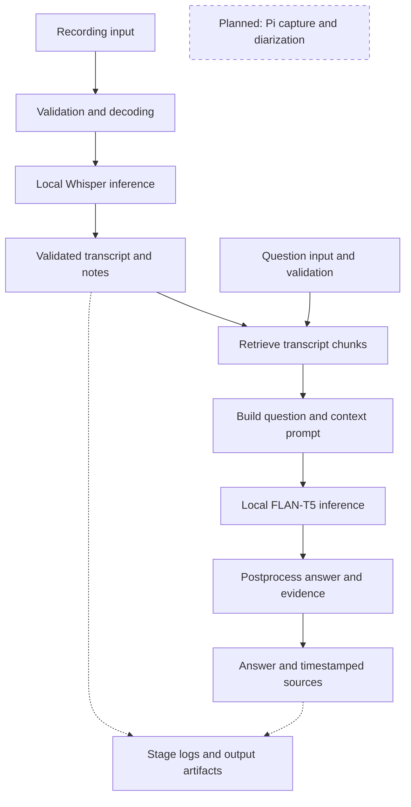

# SecureNote: A Local Meeting Recorder

Michael Grajera  |  ECE 6540: AI Architecture  |  Project Assignment 2  |  October 23, 2026

I want SecureNote to make a class or meeting easier to review without taking notes throughout the discussion. The prototype accepts a recording, transcribes it locally, selects useful passages, and answers questions using the transcript. The recorder is emulated on the same computer as the processor. Later, it can move to a Pi Zero 2 W while a laptop or server runs the models.

## 1. Implemented architecture

Figure 1. The stored transcript supplies evidence to the RAG pipeline before answer generation.



The recorder queues a local copy and sends it to a separate receiver process. The receiver checks the token, byte count and SHA-256 before acknowledging storage. Media must be nonempty, at most 2 GiB, and contain decodable audio of no more than two hours. FFprobe inspects the file and FFmpeg converts it to mono PCM. Whisper produces timestamped text; postprocessing checks the segment format and groups selected sentences into notes.

The required additional component is RAG. A question retrieves up to three transcript chunks. Those chunks become context in the prompt sent to FLAN-T5-small, which generates a short answer locally. The application attaches matching source timestamps and lets the user listen or save the answer. If retrieval returns nothing, it reports "Not found in this recording" and skips generation. Ordinary FFmpeg calls are not being counted as AI tool calls.

The browser also provides the full transcript, editable notes, search, export and deletion. Each pipeline logs input size, stages, latency and output metadata. Content stays out of default logs; transcript and answer files are stored separately. The synthetic demonstration enables answer text in its logs so the results can be inspected.

# 2. Three complete example runs

The demo transferred and transcribed three synthetic recordings, then answered one question about each transcript. It ran on a Linux AMD EPYC 9V74 test host with Python 3.12.14 and four CPU threads per model. These are not laptop or Pi timings. Python socket connections were blocked during the RAG runs; local generation still completed.

## A. Business meeting

Input: business.wav, 826,348 bytes, 18.74 seconds of decoded audio.
Question: When will Alice send the revised budget?

Generated answer: "by Friday"
Retrieved evidence [7.04 s]: Alice will send the revised budget by Friday.

Transcription produced 6 segments and 5 notes. Recording pipeline: 2.808 s. RAG request: 2.502 s; 1 retrieved chunk, 47 prompt tokens.

```text
{"stage":"input","event":"received","input_characters":40}
{"stage":"model_inference","event":"completed","latency_ms":91.58}
{"stage":"output","event":"result","answer":"by Friday"}
```

## B. Class lecture

Input: lecture.mp3, 98,238 bytes, 24.44 seconds of decoded audio.
Question: What controls how much future rewards matter?

Generated answer: "discount factor"
Retrieved evidence [6.52 s]: Remember, the discount factor controls how much future rewards matter.

Transcription produced 4 segments and 5 notes. Recording pipeline: 1.541 s. RAG request: 0.079 s; 1 retrieved chunk, 50 prompt tokens.

```text
{"stage":"input","event":"received","input_characters":45}
{"stage":"model_inference","event":"completed","latency_ms":77.35}
{"stage":"output","event":"result","answer":"discount factor"}
```

## C. Recorder planning

Input: planning.mp4, 225,989 bytes, 22.71 seconds of decoded audio.
Question: Where did we agree to keep the original recording?

Generated answer: "encrypted drive"
Retrieved evidence [2.38 s]: We agreed to keep the original recording on an encrypted drive.

Transcription produced 7 segments and 6 notes. Recording pipeline: 1.084 s. RAG request: 0.082 s; 1 retrieved chunk, 52 prompt tokens.

```text
{"stage":"input","event":"received","input_characters":50}
{"stage":"model_inference","event":"completed","latency_ms":80.11}
{"stage":"output","event":"result","answer":"encrypted drive"}
```

These log excerpts retain selected fields from real records. The first RAG request includes 2.407 seconds of model loading; later requests reuse the loaded model. Full inputs, transcripts, notes, answers and stage logs are in examples/assignment-v05/. The short clips demonstrate the pipeline, not expected speed or accuracy for a full meeting.

One limitation remains visible in the lecture transcript: Whisper wrote "A policy map sustained to an action." Retrieval and generation cannot repair incorrect source material reliably, so the recording remains available for review.

```text
python tools/run_assignment_demo.py --output demo-assignment-new
```

Run after model setup, using a fresh output folder. This reproduces all three examples and the missing-retrieval test below.

# Stage interfaces and model choice

## 3. Two stage interfaces

Boundary A: retriever to prompt builder. The retriever takes a question string of 1-512 characters and validated transcript passages. It splits long passages at word boundaries and returns a list of up to three chunks scoring at least 0.20 under TF-IDF cosine similarity. Each chunk has {id: int, text: str, source: str, start: float, end: float, score: float}. Text is limited to 600 characters; source identifies the recording; times are seconds.

The prompt builder produces a string containing instructions, the question and the selected chunk text, plus the list of supplied chunks and its token count. The prompt is at most 512 model tokens. Only complete chunks that fit are included. The question and instructions alone must fit within 160 tokens, reserving room for context.

Invalid or missing data: reject malformed fields, duplicate IDs, empty text, nonfinite scores/times, out-of-range values and an oversized question. Empty retrieval returns an explicit not_found result and never calls the generator. If chunks exist but none fits the prompt, the run fails with a clear error rather than silently truncating the context.

Boundary B: answer generator to postprocessing. Input is the decoded model response as a string, along with the exact chunks supplied in the prompt. Decoding is limited to 64 new tokens. Output is {answer: str, status: str, sources: list}, with source records carrying their original text, recording ID, timestamps and retrieval score.

Invalid or missing data: empty, non-string, oversized or token-limit responses fail validation. Postprocessing normalizes spacing and checks whether the answer wording occurs in a supplied chunk. A match produces answered status and source links; an unmatched response becomes needs_review. An explicit model abstention becomes not_found. This conservative check can reject a valid paraphrase and cannot establish factual correctness; source links are assigned by code, not invented by the model.

## 4. Models, precision and assumptions

Whisper base.en handles transcription through faster-whisper 1.2.1/CTranslate2 4.6.0. I chose it to get a small local prototype running; its model directory is about 141 MiB. It uses CPU int8 here. The three recording pipelines took 1.084-2.808 seconds, and transcription errors occurred. Without a float32 comparison, I cannot attribute those errors to quantization.

FLAN-T5-small handles answers through Transformers 4.57.1 and PyTorch 2.8.0. Its loaded model has 76,961,152 parameters; the checkpoint is about 294 MiB. It runs on CPU in float32, without quantization, and generated these short answers in 77-92 ms after loading. It was chosen for a small memory footprint and simple local setup, not advanced reasoning. Both models require one-time downloads and local compute, with no paid inference API. Whisper CUDA support exists but was not verified on the target laptop.

Assumption 1: inputs contain understandable English with limited overlapping speech. Noise and unfamiliar terminology can damage the transcript before retrieval begins.

Assumption 2: a short answer can often be found in a few transcript passages. The generator may still choose the wrong passage or misinterpret it, so consequential answers require human review.

Model documentation: huggingface.co/google/flan-t5-small; github.com/SYSTRAN/faster-whisper. The report uses measured prototype results rather than claiming benchmark accuracy.

# Failure test and remaining work

## 5. Failure test: missing retrieval evidence

For the business-meeting question, the normal retriever finds "Alice will send the revised budget by Friday." The failure test deliberately replaces that result with an empty list before prompt building. The recording and question are unchanged, so the answer exists in the transcript but is unavailable to the generator.

The system did not crash or quietly answer from model memory. It returned "Not found in this recording," with no sources, in 0.62 ms. The prompt-building and model-inference stages were explicitly skipped. The test therefore checks the retriever-to-prompt boundary: it accepts an empty list as a valid no-evidence result and prevents an unsupported generation call.

```text
{"stage":"retrieval","event":"result","chunk_count":0}
{"stage":"model_inference","event":"skipped","reason":"no_evidence"}
{"stage":"run","event":"finished","status":"not_found",
 "latency_ms":0.62}
```

Nothing passed through to generation in this test. The remaining weakness is that "not found" can mean retrieval missed an answer that is present. I would add labeled retrieval tests, track empty-result rates and assess a semantic retriever before changing the threshold. The message should remain cautious: it is not proof that the meeting never discussed the subject. A separate corrupted-upload test also remains in the demo.

## 6. Comparison with Assignment 1 and next steps

The original local speech-to-notes idea is working, with validation, timestamped output, logging and human review. The prototype also implements a recorder queue and acknowledged transfer, playback, editable notes, deletion, and local RAG answers. Audio/video support expanded beyond MP3/WAV, with a 2-GiB size cap and the same two-hour duration limit.

The Pi is still emulated with recording files; its microphone adapter is not hardware-tested. Base.en replaces the proposed large-v3 model. Sentence scoring produces automatic notes, while FLAN-T5 answers retrieved-context questions; it does not replace the proposed full-meeting Qwen summarizer. Diarization, inferred owners, semantic topic summaries, automatic model fallback, cache expiration and production deployment are missing. Audio and transcripts are retained for review instead of the original automatic-deletion policy.

The fragile parts are transcription quality, word-based retrieval and the small answer model. Before real users depend on it, I would monitor queue age, stalled jobs, latency percentiles, errors, disk usage, empty retrievals and needs_review results. Human spot checks are needed for accuracy. Next steps include tested Pi capture, per-device credentials, encrypted storage, retention rules and a process supervisor for hard timeouts and recovery.

## Running it and protecting the recordings

The README provides Windows installation commands for both models. Install FFmpeg/ffprobe, base requirements, CPU PyTorch and requirements-rag.txt first. Then run:

```text
python securenote.py download-model --model base.en
python ask.py download-model
python review.py
python tools/run_assignment_demo.py --output demo-assignment-new
```

All inference uses local files. The browser requires a private session and checks mutation requests; remote recorder transfer requires verified HTTPS. Local files are plaintext unless the volume is encrypted. Trash retains recordings until permanent deletion, which also removes this workspace's saved answers but not independent copies or backups.

Validation: 35 tests passed, plus browser checks of local RAG, evidence playback, saved notes and missing evidence. Submit this PDF with SecureNote_Prototype.zip, which includes the matching report, code, README, synthetic recordings and logs.
